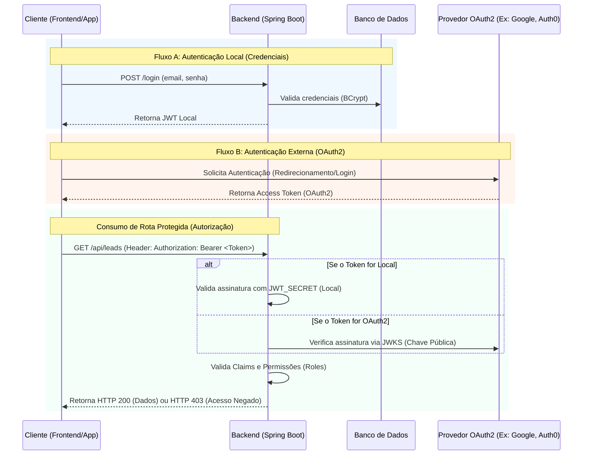

# 🎫 Tarefa: Implementação de Autenticação Híbrida (OAuth2 + JWT Local)

## 📌 Contexto
Para garantir a segurança da nossa API de leads e oferecer flexibilidade na aquisição de usuários, precisamos implementar um sistema de controle de acesso (AuthN/AuthZ) híbrido. O sistema deve suportar tanto **credenciais locais** (onde emitimos nosso próprio token JWT) quanto autenticação delegada utilizando o padrão **OAuth2 / OpenID Connect** (onde aceitamos tokens emitidos por um Provedor de Identidade externo - IdP). Toda a infraestrutura será baseada em **Java/Spring Security**.

## 🎯 Objetivos (Critérios de Aceite)
1. **Login Local (JWT):** Implementar endpoint `POST /api/auth/login` que valide credenciais internas (criptografadas via BCrypt) e retorne um token JWT assinado pela nossa API.
2. **Login OAuth2 (Resource Server / Client):** Configurar o Spring Security para atuar como um *Resource Server*, capaz de validar tokens de acesso (geralmente JWTs) emitidos por um Authorization Server / IdP externo.
3. **Filtro de Segurança Unificado:** O *SecurityFilterChain* deve ser capaz de inspecionar o header `Authorization: Bearer <token>`, identificando se é um token local (validado via chave simétrica) ou um token OAuth2 (validado via chaves públicas / JWKS do provedor).
4. **Resolução de Permissões (Roles):** Mapear de forma transparente os *claims* de ambos os tipos de tokens para o contexto de segurança do Spring (ex: mapear roles para permitir anotações como `@PreAuthorize("hasRole('ADMIN')")`).

## 🔄 Fluxos de Autenticação e Autorização

## 🛠️ Especificações Técnicas e Diretrizes
* **Dependências (`pom.xml`):** Adicionar `spring-boot-starter-security`, `spring-boot-starter-oauth2-resource-server` e `spring-boot-starter-oauth2-client` (se houver a necessidade do backend gerenciar o fluxo de código do OAuth).
* **Configuração de Ambiente:** As credenciais do IdP (Client ID, Client Secret, Issuer-URI) e o segredo do JWT local (`JWT_SECRET`) devem ser passadas via variáveis de ambiente/secrets no container (`docker-compose.yml`), **nunca expostos no código**.
* **Personalização do JWT Converter:** Será necessário criar um `JwtAuthenticationConverter` customizado para normalizar as *Roles/Authorities*, já que o payload do token local pode diferir do payload de um token OAuth2 (como os emitidos pelo Keycloak ou Google).

## 📚 Documentação Oficial de Referência
* [Spring Security - OAuth2 Resource Server](https://docs.spring.io/spring-security/reference/servlet/oauth2/resource-server/index.html)
* [Spring Security - OAuth2 Login (Client)](https://docs.spring.io/spring-security/reference/servlet/oauth2/login/index.html)
* [IETF RFC 6749 - The OAuth 2.0 Authorization Framework](https://datatracker.ietf.org/doc/html/rfc6749)
* [IETF RFC 7519 - JSON Web Token (JWT)](https://datatracker.ietf.org/doc/html/rfc7519)
* [Spring Security - JWT Authentication Architecture](https://docs.spring.io/spring-security/reference/servlet/oauth2/resource-server/jwt.html)